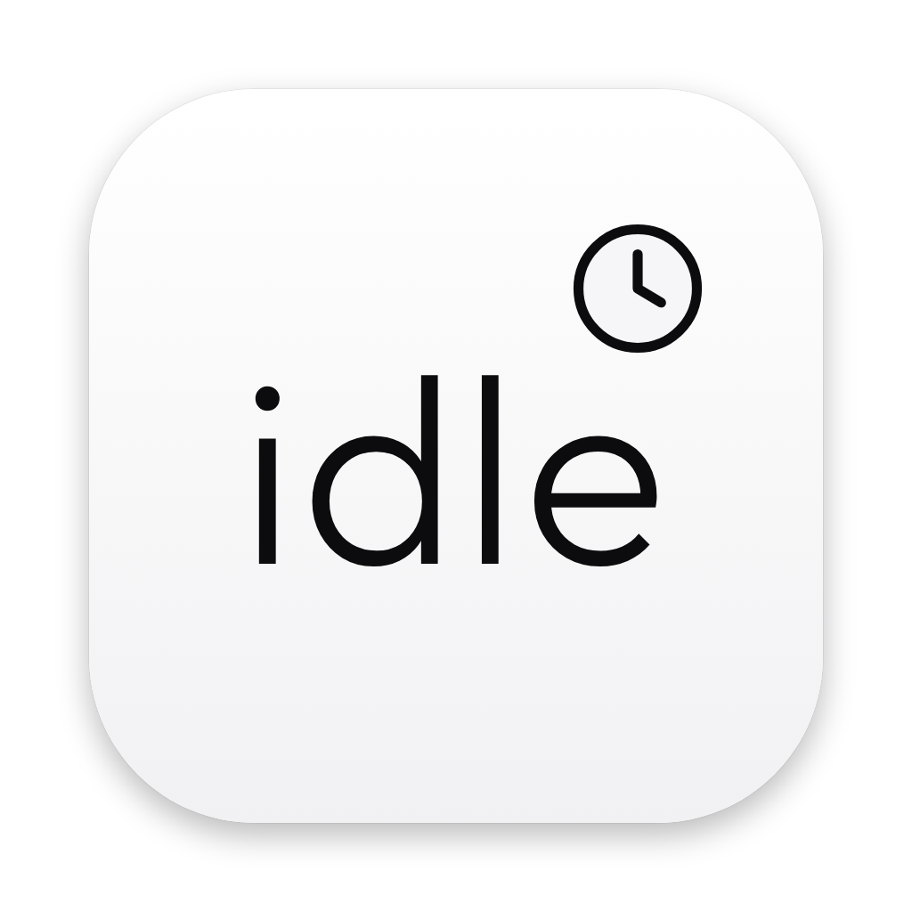
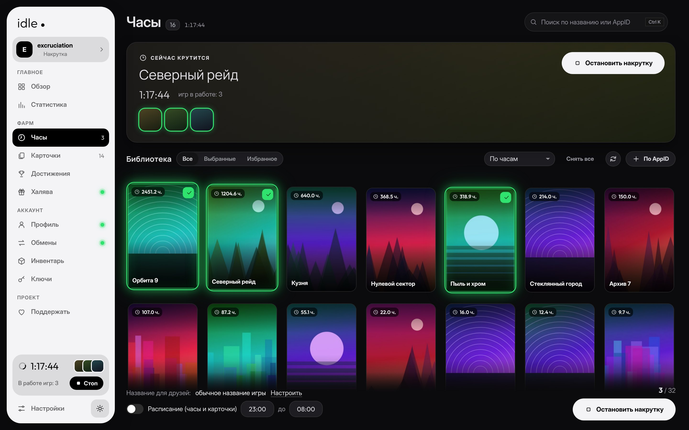
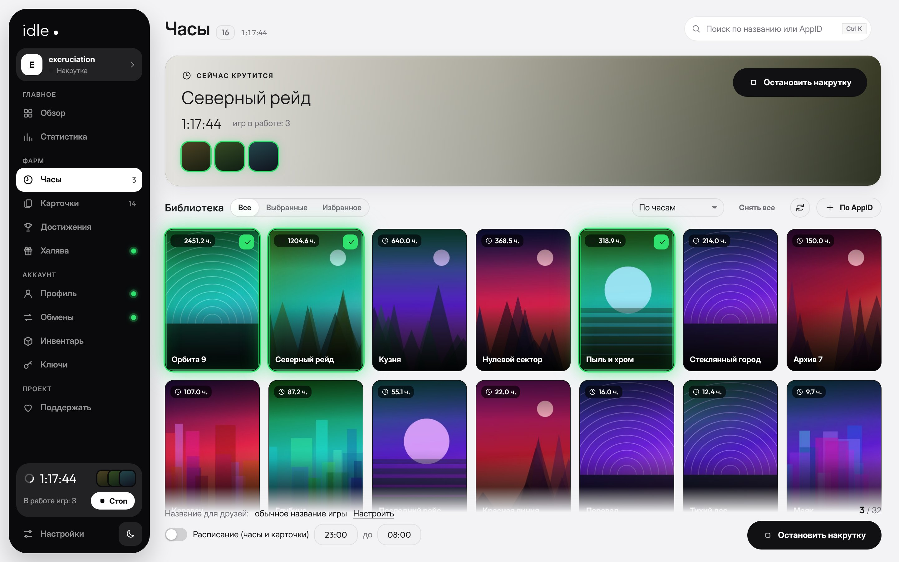
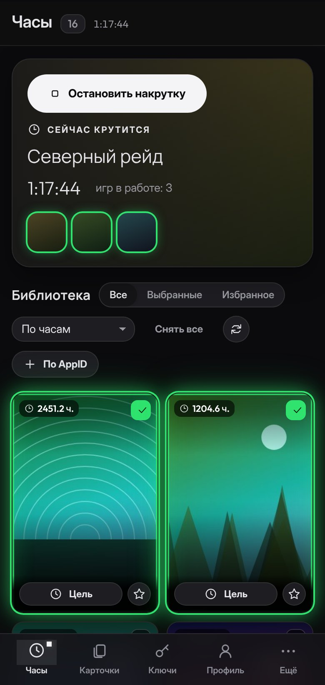
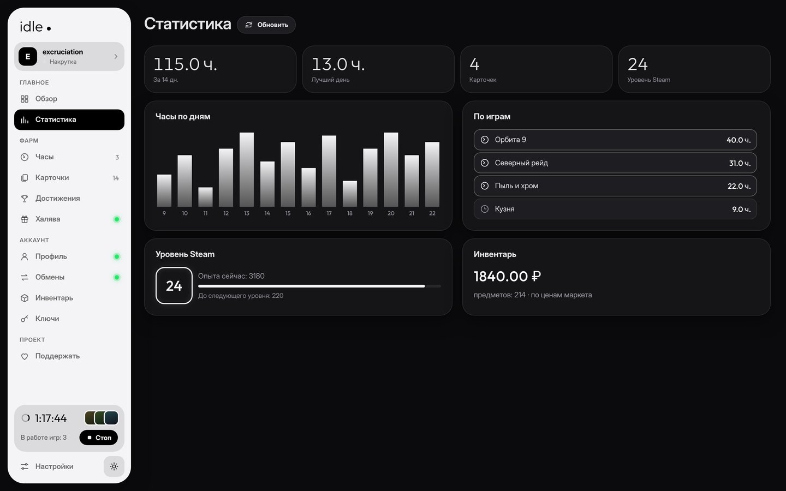
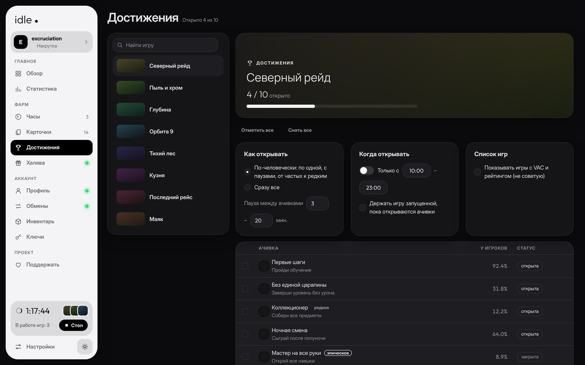
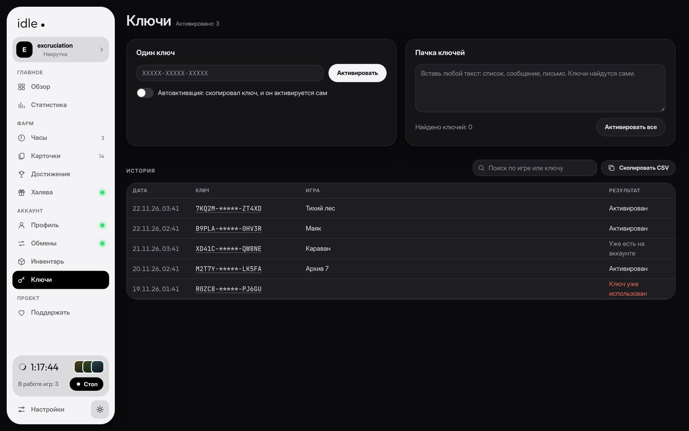

<p align="center"></p>

<h1 align="center">SteamIdleMachine</h1>

<p align="center">
  Idles hours, farms cards and looks after your Steam accounts while you are away.<br>
  Free. macOS, Windows, Linux. <a href="README.ru.md">Русский</a>
</p>

<p align="center">
  <a href="../../releases/latest"><b>Download the latest version</b></a>
</p>

<p align="center"></p>

## What it does

| | |
|---|---|
| **Hours** | Up to 32 games per account at once, with a goal in hours for each game and a schedule. |
| **Cards** | Every game with card drops runs until the last card. Skip and priority lists are built in. |
| **Achievements** | Unlock all at once or one by one, at a natural pace. Shows how rare each one is. |
| **Keys** | Paste any text: keys are found, queued within Steam's limits and kept in a history. |
| **Freebies** | Claims free games and sale stickers, walks the discovery queue, watches wishlist discounts. |
| **Inventory and market** | Live prices, selling one item, a selection or all duplicates, your listings. |
| **Trades and badges** | Accepts gifts, crafts badges, confirms listings with a `.maFile`. |
| **Profile** | Your own game names for friends, a day and a night nickname, online status, auto-reply. |
| **Statistics** | Hours by day and by game, cards, keys, Steam level. |
| **Accounts** | As many accounts as you like. Sign in with a password or a QR code, switch in one click. |

<p align="center">
  
  
</p>

Light and dark. The sections stand in the island on the left; on a phone they move to a bar at the bottom. The app lives in the menu bar or the tray, opens on your phone over Wi-Fi and can report to your own Telegram bot.

<p align="center">
  
  
  
</p>

## Install

Builds are attached to the [latest release](../../releases/latest).

| System | File | How to run |
|---|---|---|
| macOS 11 or later, Apple Silicon and Intel | `.zip` | Move SteamIdleMachine.app to Applications and run the command below. |
| Windows 10 and 11, x64 and ARM | `.exe` | Run it. If SmartScreen asks, choose More info, then Run anyway. |
| Linux, x64 and arm64 | `.tar.gz` | Unpack and run `./steamidler`. The window opens in your browser. |

The macOS app is not signed, so it needs one command in Terminal, once:

```sh
xattr -cr /Applications/SteamIdleMachine.app && open /Applications/SteamIdleMachine.app
```

## Your data

- The password goes only to Steam and is not stored.
- The session is kept encrypted: in the macOS Keychain or in Windows DPAPI.
- The window is reachable only on your computer, behind a key that changes on every start.
- Nothing is sent anywhere but Steam. To Telegram only if you connect your own bot.

## Build from source

Go 1.24 and Python 3. No third-party dependencies.

```sh
git clone https://github.com/excruciation69/steamidlemachine && cd steamidlemachine
./scripts/build.sh
```

Files for every system appear in `dist`.

<br>

<p align="center"><sub><a href="LICENSE">MIT License</a>. © excruciation. Questions and ideas: <a href="https://t.me/excruciation69">Telegram</a>. Not affiliated with Valve Corporation.</sub></p>
