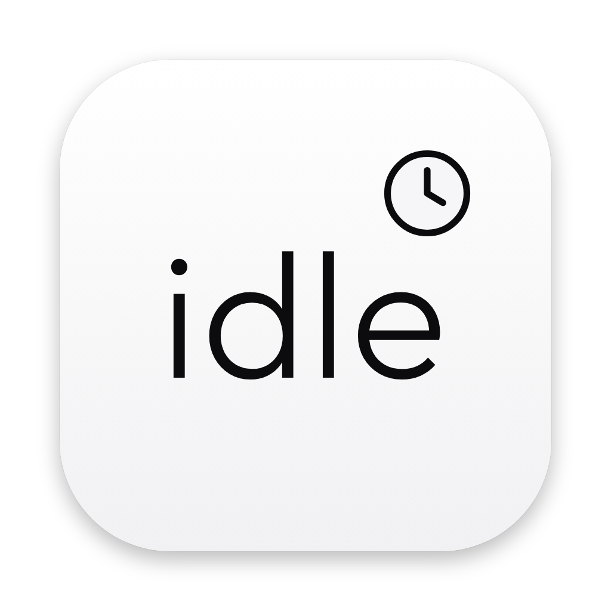
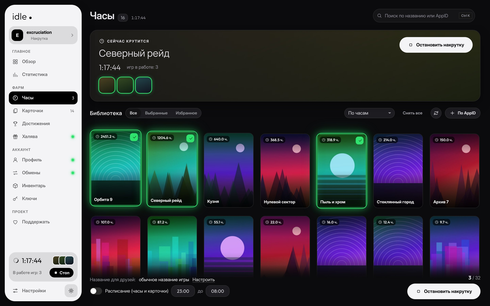
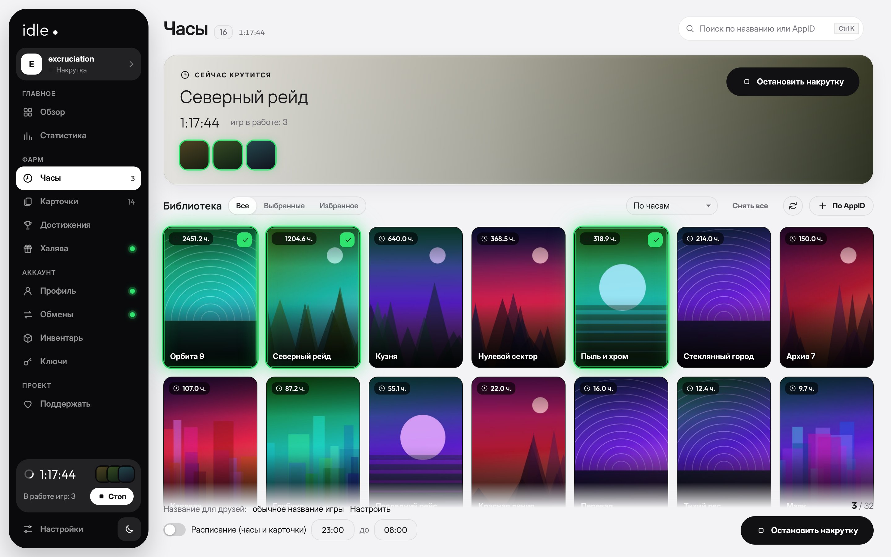
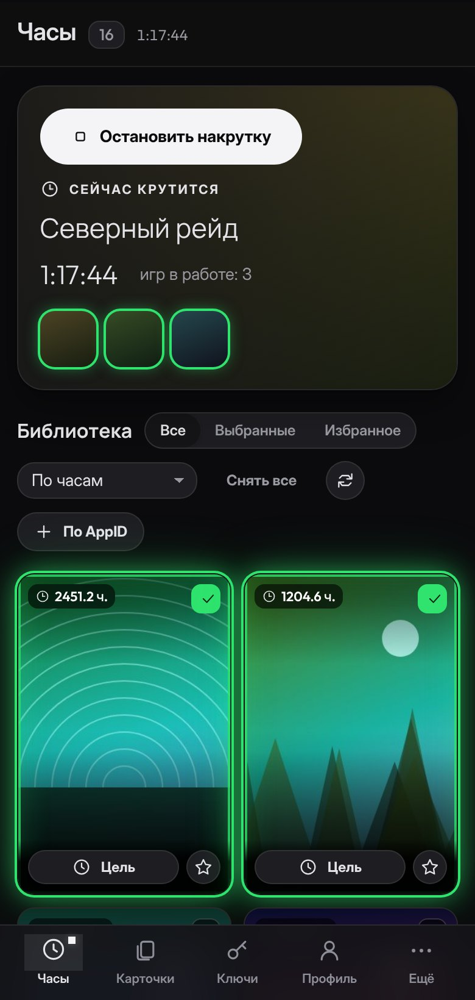
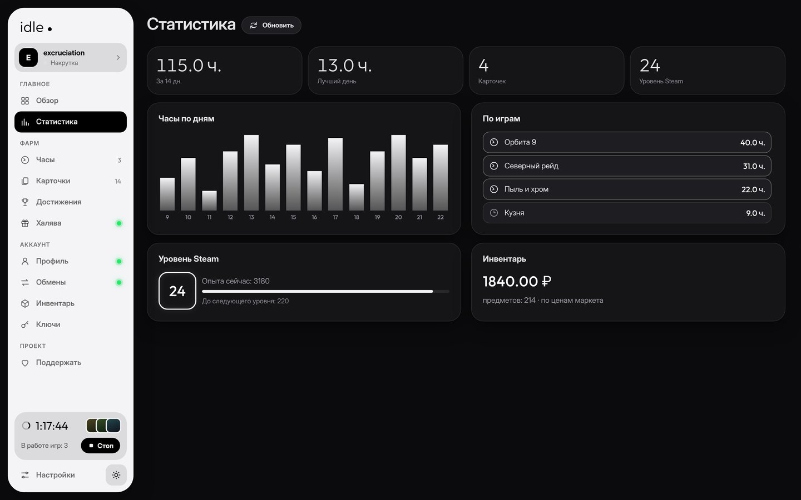
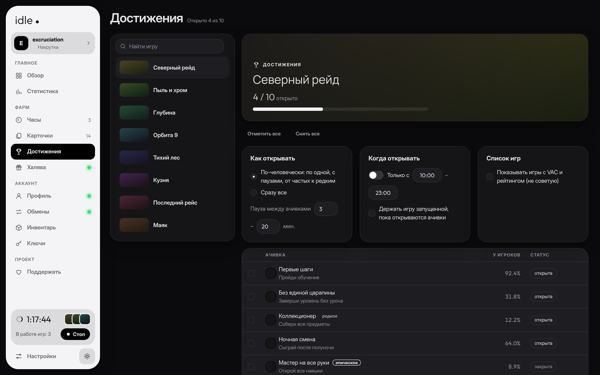
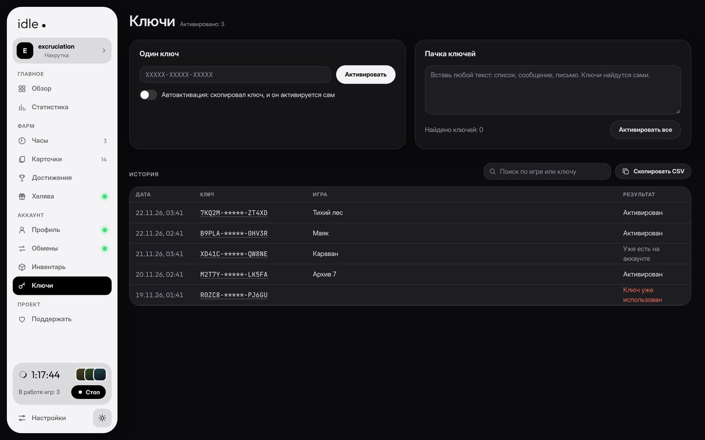

<p align="center"></p>

<h1 align="center">SteamIdleMachine</h1>

<p align="center">
  Крутит часы, фармит карточки и следит за аккаунтами Steam, пока тебя нет.<br>
  Бесплатно. macOS, Windows, Linux. <a href="README.md">English</a>
</p>

<p align="center">
  <a href="../../releases/latest"><b>Скачать последнюю версию</b></a>
</p>

<p align="center"></p>

## Что умеет

| | |
|---|---|
| **Часы** | До 32 игр на аккаунт одновременно, цель по часам для каждой игры и расписание. |
| **Карточки** | Каждая игра с карточками крутится до последней. Списки исключений и приоритетов уже внутри. |
| **Достижения** | Открываются все сразу или по одному, в естественном темпе. Видно, насколько редкое каждое. |
| **Ключи** | Вставь любой текст: ключи найдутся, встанут в очередь с учётом лимитов Steam и сохранятся в истории. |
| **Халява** | Забирает бесплатные игры и наклейки распродаж, проходит очередь просмотра, следит за скидками в вишлисте. |
| **Инвентарь и маркет** | Цены в реальном времени, продажа одного предмета, выбранных или всех дубликатов, свои лоты. |
| **Обмены и значки** | Принимает подарки, крафтит значки, подтверждает лоты через `.maFile`. |
| **Профиль** | Свои названия игр для друзей, дневной и ночной ник, статус в сети, автоответ. |
| **Статистика** | Часы по дням и по играм, карточки, ключи, уровень Steam. |
| **Аккаунты** | Сколько угодно аккаунтов. Вход по паролю или по QR-коду, переключение в один клик. |

<p align="center">
  
  
</p>

Светлая и тёмная тема. Разделы стоят в островке слева, на телефоне они уходят в нижнюю панель. Приложение живёт в строке меню или в трее, открывается на телефоне по Wi-Fi и может писать в твой Telegram-бот.

<p align="center">
  
  
  
</p>

## Установка

Сборки прикреплены к [последнему релизу](../../releases/latest).

| Система | Файл | Как запустить |
|---|---|---|
| macOS 11 и новее, Apple Silicon и Intel | `.zip` | Перенеси SteamIdleMachine.app в «Программы» и выполни команду ниже. |
| Windows 10 и 11, x64 и ARM | `.exe` | Запусти. Если SmartScreen спросит, нажми «Подробнее», затем «Выполнить в любом случае». |
| Linux, x64 и arm64 | `.tar.gz` | Распакуй и запусти `./steamidler`. Окно откроется в браузере. |

На macOS приложение не подписано, поэтому один раз нужна команда в Терминале:

```sh
xattr -cr /Applications/SteamIdleMachine.app && open /Applications/SteamIdleMachine.app
```

## Твои данные

- Пароль уходит только в Steam и не сохраняется.
- Сессия хранится в зашифрованном виде: в связке ключей macOS или в DPAPI Windows.
- Окно доступно только на твоём компьютере, за ключом, который меняется при каждом запуске.
- Никуда, кроме Steam, ничего не отправляется. В Telegram только если ты подключишь своего бота.

## Сборка из исходников

Нужны Go 1.24 и Python 3. Сторонних зависимостей нет.

```sh
git clone https://github.com/excruciation69/steamidlemachine && cd steamidlemachine
./scripts/build.sh
```

Готовые файлы для всех систем появятся в папке `dist`.

<br>

<p align="center"><sub><a href="LICENSE">Лицензия MIT</a>. © excruciation. Вопросы и идеи: <a href="https://t.me/excruciation69">Telegram</a>. Не связано с Valve Corporation.</sub></p>
